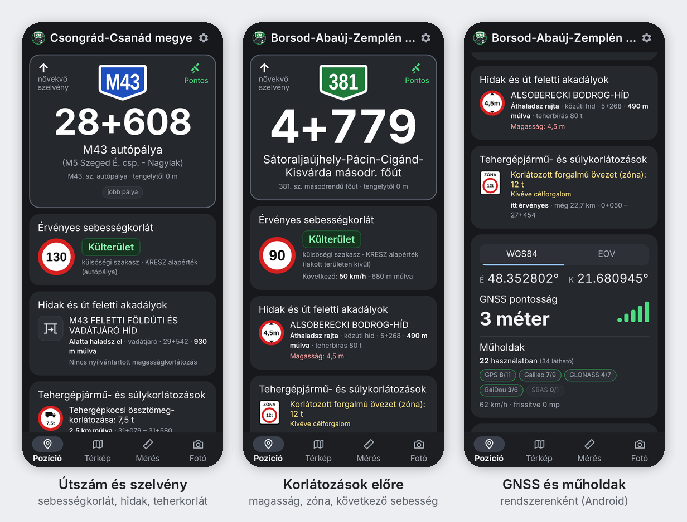
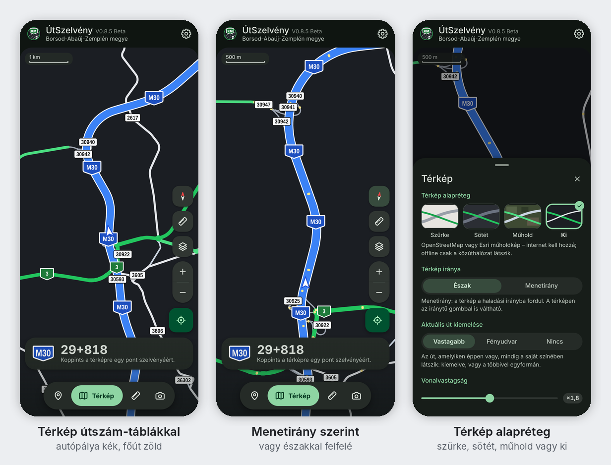

<h1 align="center">ÚtSzelvény</h1>

<b>Kilométerkő minden méteren – a zsebedben.</b>

Az <b>ÚtSzelvény</b> megmutatja, melyik országos közúton és melyik kilométerszelvényben állsz, internet nélkül is.
A telefon GNSS pozícióját a közúthálózat adataihoz illeszti. Egy pillantással látod az útszámot
és a szelvényt, valamint mindazt, ami az adott szakaszra vonatkozik.

Terepi munkára is alkalmas. Útszám és szelvény alapján megkeres egy pontot vagy egy útszakaszt a térképen. Mérhetsz vele szelvénytől szelvényig, akár több úton át, vagy pontokat lerakva a térképen.
Fotóidra ráírja a helyet és az időt, a méréseidet pedig elnevezheted és akár CSV-be mentheted.

Böngészőben és Android-alkalmazásként is fut. Az úthálózati adatok a készüléken vannak, így a szelvényezés internet
nélkül is működik. Csak a térkép alapréteghez kell internetkapcsolat.

**Verzió:** V1.3.2.8 · [Változásnapló](CHANGELOG.md) · © 2026 Szászi Dániel · Licenc: GPL-3.0

## Funkciók

### Pozíció
Útszám az útjelző tábla formájában, kilométerszelvény (km+m), szelvényirány, az út neve és kategóriája.
Alatta az érvényes sebességkorlát (belterület / külterület), átkelési szakaszon a település nevével, a következő 3 km hídjai és út feletti akadályai,
a tehergépjármű- és súlykorlátozások, a GNSS adatok, valamint a kezelő, a megyei igazgatóság és a mérnökség. Párhuzamos utaknál a közeli út egy koppintással választható.
Az Android alkalmazás a használt és látható műholdakat is mutatja rendszerenként (GPS, Galileo, GLONASS, BeiDou…).
Budapest belterületén jelzi, hogy a fővárosi és kerületi utak nem részei az országos közúthálózatnak.

### Térkép
Országos közúthálózat útszám-táblákkal (autópálya, autóút kék, főút zöld), alaprétegként OpenStreetMap (világos vagy sötét)
vagy műholdkép. Északkal felfelé vagy menetirány szerint forgatva. Koppintásra megmutatja a pont útját és szelvényét; onnan a pont elmenthető keresésként, az Utcakép gomb megnyitja a Google Utcaképet (Google Térkép alkalmazásban vagy új böngészőlapon) a menetirány felé nézve, az Adatok pedig a szakasz minden adatát mutatja (kezelő vállalat, megyei igazgatóság, mérnökség, sávok, burkolat, forgalom, sebességkorlát, terület, híd, tehergépjármű-korlátozás). A kilométerszelvények pontként és az út mellé mutató vonalkával látszanak (osztott pályán kifelé), a hidak nagyobb nagyításnál (mindkettő kikapcsolható, a nagyítási szint állítható); az átkelési szakaszok (ahol az út lakott területen halad át) bekapcsolható halvány piros sávval jelölhetők; ahol egy országos út egy másik felett halad át, a magasságkorlát az alatta haladó úton jelenik meg.

### Keresés
Útszám és kilométerszelvény (km+m) megadásával megkeresi a pontot a térképen, kezdő és záró szelvénnyel pedig
a teljes útszakaszt (úton mért és szelvény szerinti hosszal, megyével, kezelővel). Nem létező szelvénynél a legközelebbit mutatja.
Koordináta módban WGS84 vagy EOV koordinátát (beírva vagy beillesztve, a saját GNSS-pozíció egy gombbal) a legközelebbi országos út szelvényéhez köt – pontként vagy két ponttal szakaszként; ezek a keresések limezöld színűek.
A keresések elmenthetők és elnevezhetők, egyenként kapcsolóval jeleníthetők meg a térképen. Az alkalmazás minden koordinátája hosszú nyomással vágólapra másolható.

### Mérés
- **GNSS mérés:** indítás és leállítás között méri a megtett utat és a szelvény szerinti hosszt; több úton át szakaszokra bont, közbenső pontokat rögzít.
- **Mérés a térképen:** lerakott pontok között légvonal, úton mért (legrövidebb útvonal az országos hálózaton) és szelvény szerinti távolság.
- **Mentett mérések:** elnevezhetők, térképen megjeleníthetők, CSV-be exportálhatók (a kezelő vállalattal, megyei igazgatósággal és mérnökséggel együtt).

### Fotó
Fénykép a helyszínről útszámmal, szelvénnyel, dátummal és idővel a kép tetején (koordináta és égtáj is kérhető),
a pozíció a kép adatai közé (EXIF) is bekerül. Az Android alkalmazás alapból a DCIM / ÚtSzelvény mappába ment (a kamera mappája mellett);
a beállításokban a Képek / ÚtSzelvény vagy bármely választott mappa is megadható.
Az Android alkalmazásban a hangerőgombokkal (vagy Bluetooth-os távkioldóval) is lehet exponálni.

Valódi, az alkalmazással készült fotók (Pixel 7 Pro, 2026. 11. 19.), a bélyegzővel együtt, ahogy az alkalmazás elmentette; kettő a Fotó oldal képernyőképébe illesztve, ahogy exponálás előtt látszik.

### HUD mód
A műszerfalra fektetett telefon képe a szélvédőn tükröződik: fekete háttér, nagy, fényes útszám és szelvény,
igény szerint haladási irány, sebesség és sebességkorlát. Tükrözés, fekvő / álló tájolás és szín állítható;
az Android alkalmazás teljes képernyőre vált és maximális fényerőre állítja a kijelzőt. A beállítások HUD lapján indítható, ott vannak a további beállításai is.

### Beállítások
Fülekre bontva (Általános, Pozíció, Térkép, Keresés, Mérés, Fotó, HUD, Névjegy); mindig az aktuális oldal fülén nyílik meg.
Koordináták: WGS84 (alapértelmezett) vagy EOV.

## Használat

- **Kezdőlap:** https://utszelveny.hu/ – rövid bemutató, az „ÚtSzelvény indítása” gombbal.
- **Webalkalmazás (telepítés nélkül):** https://utszelveny.hu/app/ – a legutóbbi stabil kiadás.
  Böngészőben megnyitva az első betöltés után internet nélkül is működik, könyvjelzőként menthető az asztalra.
  Ajánlott böngésző: Chrome (Androidon) vagy Safari (iPhone-on). A Firefox Androidon nem támogatott, mert csak ritkán frissíti a helyadatot.
  A `main` ág legfrissebb, még nem kiadott állapota (fejlesztői oldal, saját mentett adatokkal): https://utszelveny.hu/dev/
- **Android APK (telepítve):** https://github.com/schafler55/utszelveny/releases/latest – a legutóbbi stabil kiadás (pl. `UtSzelveny-V1.0.apk`).
  Letöltés után engedélyezni kell az ismeretlen forrásból történő telepítést.
  A `main` ág legfrissebb, még nem kiadott állapota: [apk-latest](https://github.com/schafler55/utszelveny/releases/tag/apk-latest) –
  külön „ÚtSzelvény DEV” alkalmazásként települ a rendes mellé, saját mentett adatokkal és saját ikonnal (piros keret, „DEV” felirat).
- **Frissítés a béta változatokról (V0.x) a V1.0-ra:** a V1.0-tól az APK új aláírókulccsal készül, ezért a béta APK-t előbb el kell távolítani.
  Ezzel a mentett mérések és keresések is törlődnek, ezért előtte érdemes CSV-be menteni őket.
- **Frissítések:** indításkor az alkalmazás megnézi, megjelent-e új stabil verzió (Beállítások → Általános → Frissítések, kikapcsolható; kézzel: Névjegy → Frissítések → Ellenőrzés).
  A webalkalmazás a „Frissítés” gombra azonnal, a „Később” után a következő indításkor tölti be az új verziót.
  Az Android alkalmazás a „Frissítés” gombra megnyitja az új APK letöltését; a letöltött fájlt megnyitva az Android a meglévő alkalmazásra telepíti. Egy verzió ki is hagyható.
  A mentett mérések, keresések és beállítások frissítéskor megmaradnak.
  A fejlesztői változat (https://utszelveny.hu/dev/ és az „ÚtSzelvény DEV” APK) ugyanígy a `main` ág új verzióira figyel; a tesztváltozatokban nincs frissítéskeresés.

A térkép alapréteg (OpenStreetMap vagy Esri műholdkép) internetkapcsolatot igényel; minden más adat az alkalmazásba van építve.
A térkép északkal felfelé vagy menetirány szerint elforgatva is használható.

## Felépítés

| Fájl / mappa | Tartalom |
|---|---|
| `site/` | A kezdőlap (`index.html`, a háttér `hatter.svg`, képek a `kepek/` mappában); a `main` ágé a https://utszelveny.hu/ címre kerül |
| `web/` | A webalkalmazás; a legutóbbi stabil kiadásé a https://utszelveny.hu/app/, a `main` ágé a https://utszelveny.hu/dev/ címre kerül |
| `web/index.html` | A teljes alkalmazás (kód + beépített úthálózati adatok), egyetlen fájl; a fejlécben lévő Content Security Policy sorolja fel, mely szerverekhez fordulhat (új térképréteg vagy szolgáltatás esetén bővíteni kell) |
| `web/sw.js`, `web/manifest.webmanifest`, `web/icon-*.png` | Telepíthető webalkalmazás (PWA) offline gyorsítótárral |
| `android/` | Android keret (WebView), amely a `web/index.html`-t futtatja; a mentett adatok nem kerülnek a telefon Google biztonsági mentésébe (`allowBackup="false"`, `res/xml/data_extraction_rules.xml`) |
| `.github/workflows/android.yml` | Megépíti az APK-t aláírás nélkül, majd külön lépésben aláírja: a stabil kiadást (`V*` címke) a kiadási kulccsal a védett `release` környezetből, a `main` ágat (`apk-latest`) és a teszt ágakat a fejlesztői kulccsal „ÚtSzelvény DEV” néven |
| `.github/scripts/sign-apk.sh` | Az APK aláírása (zipalign + apksigner); a kulcsfájl csak az aláírás idejére jön létre |
| `.github/dependabot.yml` | A GitHub Actions lépések commit SHA-ra rögzítettek; a Dependabot havonta javasolja a frissítésüket |
| `.github/workflows/pages.yml` | Kiteszi a weboldalt a GitHub Pagesre: a kezdőlapot (`site/`), a legutóbbi stabil kiadás `web/` mappáját az `app/` alá, a `main` ágat a `dev/` alá, és minden másik ágból egy teszt oldalt (`test/<ág>/`); a törölt ág teszt oldala eltűnik. Új stabil kiadás közzétételekor magától frissül |
| `CHANGELOG.md` | Változásnapló: mi változott az egyes verziókban |
| `SECURITY.md` | Biztonsági hiba zárt bejelentése (GitHub „Report a vulnerability” vagy e-mail), magyarul és angolul |
| `web/szovegek.html` | Az alkalmazás összes szövege képernyőnként (kereshető, szerkeszthető), a `main` ág szerint: https://utszelveny.hu/dev/szovegek.html |
| `tools/szovegek.py` | Ellenőrzi a `web/index.html` szövegblokkját (érvényes JSON, minden kulcs megvan); a build is futtatja |
| `tools/verzio.py` | A verziószám: ellenőrzi, hogy minden helyen ugyanaz (oldal, Névjegy, `sw.js`, `build.gradle`, README), és egy paranccsal mindenhol átírja (`python3 tools/verzio.py 1.3.0.1`); a build és a stabil kiadás címkéje is ezzel ellenőrződik |
| `tools/smoke_test.py`, `.github/workflows/checks.yml` | Minden feltöltéskor: szövegek, verziószámok és böngészős füstteszt (az alkalmazás végigkattintása fej nélküli Chrome-ban, ál-GNSS-szel és ál-kamerával; JavaScript-hibánál piros) |
| `tools/adat/` | Az úthálózati adatok előállítása: a NAP-ból letöltött 13 WFS GeoJSON fájlból egy lépésben újraépíti a `web/index.html` beépített adatait, ellenőrzésekkel és összehasonlító jelentéssel (leírás: [tools/adat/README.md](tools/adat/README.md)) |
| `tools/kezdolap_hatter.py` | Megrajzolja a kezdőlap úthálózat-hátterét (`site/hatter.svg`) |
| `tools/kezdolap_og.py` | Elkészíti a link-előnézet képét (`site/kepek/og.jpg`): logó, név, szlogen, három képernyő |
| `screenshots/` | A README képei |

A webalkalmazás és az APK is ugyanabból a `web/index.html`-ből épül, ezért új verzióhoz elég azt cserélni.

## Szövegek

Az alkalmazás minden felirata, magyarázata és gombszövege egy helyen van: a `web/index.html` elején, a `<script type="application/json" id="texts">` blokkban, képernyők szerint csoportosítva (pl. `position`, `search`, `settings`). A kód csak a kulcsokra hivatkozik (`TX("search.title")`, `data-tx="search.title"`).

Áttekintés és szerkesztés: **[szovegek.html](https://utszelveny.hu/dev/szovegek.html)** – kereshető lista; a módosítások a böngészőben maradnak, a „Copy changes” rövid listát másol, a „Download index.html” a módosított teljes fájlt adja, ami GitHubon feltölthető. A `{kapcsos}` helyőrzőket (útszám, távolság…) és a HTML-jelöléseket (`<b>`, ` `) meg kell hagyni.

## Adatforrás és felelősség

- Útadatok: Magyar Közút Nonprofit Zrt. – Nemzeti Adathozzáférési Pont (NAP), statikus adatcsomagok
  (az adatállapot dátuma az alkalmazás Névjegy oldalán látszik): Országos közúthálózat, Közút neve/kategóriája/kezelője, Szelvényjelek,
  Sebességkorlátozás, Lakott területi szakaszok, Hídhasználati feltételek, Tehergépjárművekre vonatkozó
  korlátozások, Összes gépjármű forgalmi sávok száma, Burkolat típusa és szélessége, Éves keresztmetszeti
  forgalmi adatok (2025), Közúti azonosítópontok, Egyirányú útpályák, Autóbusz megállóhelyek. **Az adatokra a NAP felhasználási
  feltételei vonatkoznak, nem a GPL-3.0 licenc.**
- Térkép alapréteg: © OpenStreetMap közreműködők (ODbL). 
  Műholdkép: © Esri, Maxar, Earthstar Geographics, GIS User Community (Esri World Imagery).
- Az adatok tájékoztató jellegűek, nem hitelesek. A helyszíni jelzések és a KRESZ az irányadók.
  Vezetés közben ne kezeld az alkalmazást.

Az alkalmazás Claude Opus 5.5 segítségével készült.

## Adatvédelem

<b>Az alkalmazás nem gyűjt és nem továbbít személyes adatokat:</b> nincs fiók, reklám vagy analitika. A helyadataid, méréseid, kereséseid és beállításaid csak helyben tárolódnak, a fotók pedig közvetlenül a készülékedre mentődnek.
Az alaptérkép az OpenStreetMap és az Esri szervereiről töltődik le, így ezek a szolgáltatók – mint bármely weboldal esetében – látják az IP-címedet és a betöltött térképrészletet. Az Utcakép gomb a Google Térképet, a Névjegy Támogatás gombja a Revolut fizetési oldalát nyitja meg.
A frissítések keresése (Beállítások → Általános, kikapcsolható) a GitHub szerveréről kérdezi le a legújabb verzió számát, így a GitHub látja az IP-címedet.
A teljes tájékoztató: [Adatvédelmi tájékoztató](https://utszelveny.hu/adatvedelem.html).

## Támogatás

Az ÚtSzelvény ingyenes: nincs benne reklám, előfizetés vagy fizetős funkció. A fejlesztést a szabadidőmben végzem.
Ha hasznosnak találod, egy kávé árával támogathatod a munkámat és a további fejlesztést: **[IDE KATTINTVA](https://revolut.me/schafler55)**.
A támogatás önkéntes, és nem jár érte extra funkció. <b>A visszajelzés és az ötletek is sokat segítenek!</b>

2026. december 15-től az alkalmazás időnként, indítás után egy rövid ablakban is megkéri a rendszeres felhasználókat a támogatásra („Most nem” / „Támogatás”): a „Most nem” után legalább egy hónap és 10 megnyitás múlva kérdez újra, a „Támogatás” után egy évig nem.

## Ismert korlátok és hibák

Az alábbiak többsége az adatforrásból vagy a telefonból adódik, nem az alkalmazás hibája.
Ha olyan hibát találsz, ami itt nem szerepel, jelezd [issue-ként](https://github.com/schafler55/utszelveny/issues) vagy e-mailben: [visszajelzes@utszelveny.hu](mailto:visszajelzes@utszelveny.hu).

### Ismert korlátok

**Útadatok (NAP)**
- **Hidak:** a NAP egy hidat egyetlen szelvénypontként tárol, hossz nélkül. Ezért a térképi hídjel nem a híd valódi hosszát mutatja, a „rajta / alatta” jelzés pedig ehhez a ponthoz igazodik. Azt is ritkán adja meg, mi halad a híd alatt.
- **Hiányok, hibák:** a NAP adataiban is lehetnek hiányok (pl. az M0–M7 törökbálinti csomópontjából hiányzik egy híd). Az alkalmazás azt mutatja, ami a NAP-ban szerepel.
- **Csak az országos közutak:** a helyi (önkormányzati), a fővárosi és kerületi, valamint a magán-, erdei és mezőgazdasági utak nincsenek benne, ezeken „Úthálózaton kívül” jelenik meg. Budapesten csak az országos utak (pl. az M0) szelvényezése látszik.
- **Statikus adatok:** útlezárás, útépítés, ideiglenes vagy változtatható jelzésképű táblák nincsenek benne. Az adatok a kiadáskori NAP-állapotot mutatják, új adat az alkalmazás frissítésével érkezik.
- **Sebességkorlát:** a NAP-ban rögzített korlátozás, ennek hiányában a KRESZ személygépkocsira vonatkozó alapértéke (50 / 90 / 110 / 130 km/h). A tehergépkocsikra, autóbuszokra és utánfutós járművekre vonatkozó alacsonyabb általános korlátokat az alkalmazás nem számolja.
- **Mérnökség, megyei igazgatóság:** a NAP útszakaszonként adja meg őket. Néhány szakaszon (jelenleg 9) két mérnökség osztozik, és az adat nem tartalmazza, hol a határ: ott mindkettő neve megjelenik. A koncessziós társaságoknál nincs megyei igazgatóság. A nevek a NAP írásmódját követik (pl. „Apm.” = autópálya-mérnökség).
- **Egyirányú utak:** osztatlan úton, ha a NAP nem jelöl egyirányú szakaszt, az alkalmazás kétirányúnak veszi.
- **Autóbusz-megállók:** a NAP-ban a megállóhelyek több mint felének nincs neve („Név nélküli megállóhely”).
- **Forgalmi adatok:** a legutóbbi számlálás éves átlagai (2025), nem élő forgalom.

**Településnevek (OpenStreetMap)**
- **Csak közigazgatási települések:** az átkelési szakaszon a település (önkormányzat) neve jelenik meg, a saját helységnévtáblával rendelkező településrészeké nem. Például a 67-es úton Antalszállás helyett Boldogasszonyfa látszik.
- **A névváltás helye:** a településhatárok pontatlanok, és a NAP szakaszhatárai is eltérhetnek a tábláktól, ezért a név akár néhány tíz méterrel a valódi helységnévtábla előtt vagy után vált.

**Pontosság**
- **GNSS:** a szelvény pontossága a telefon helymeghatározásán múlik: általában néhány méter, fák alatt, bevágásban, magas épületek mellett rosszabb, alagútban nincs jel. A kiírt km+m néhány méterrel eltérhet a helyszíni kilométerkövektől.
- **Hiányzó kilométerjelek:** ahol a NAP-ban nincs kilométerjel (pl. egyes kerékpárutakon), az alkalmazás becsüli a szelvényt, ott akár több tíz méteres eltérés is lehet.
- **Közeli utak:** párhuzamos utaknál, csomóponti ágaknál és elágazásokban az alkalmazás rövid ideig a szomszédos utat is választhatja. A közeli út egy koppintással kiválasztható.
- **Mérés csak előtérben:** a GNSS-mérés csak akkor rögzít, ha az alkalmazás előtérben van és a képernyő be van kapcsolva (a „Képernyő ébren tartása” alapból be van kapcsolva). Ha közben másik alkalmazásra váltasz, a kimaradt szakaszt a mérés egyenes vonalként számolja.
- **Álló helyzetben** az alkalmazás nem ismeri a haladási irányt, ezért az irányfüggő adatok (szelvényirány, irányonként eltérő sebességkorlát) csak elindulás után biztosak.
- **EOV koordináták:** az átszámítás kb. 1 méter pontos: tájékozódásra jó, geodéziai felmérésre nem.

**Böngészők és eszközök**
- **Firefox Androidon nem támogatott:** egy-két helyadat után nem frissíti a pozíciót. Chrome ajánlott. (A figyelmeztetés a „Megértettem” gombbal bezárható.)
- **Hozzávetőleges helyadat (Android 12-től):** ha az Android alkalmazás csak a hozzávetőleges helyet kapja meg, nem tudja megállapítani az utat; ilyenkor a Pozíció oldal tetején figyelmeztetés jelenik meg „Pontos hely engedélyezése” gombbal.
- **Alkalmazásokba épített böngészők** (Facebook, Messenger stb.): gyakran nem adják át a helyadatot, ezért érdemes az oldalt Chrome-ban megnyitni.
- **iPhone:** kevésbé tesztelt. A Safari alsó sávja eltakarja a térkép alját; a főképernyőre tett webalkalmazásban nincs böngészősáv.
- **Csak az Android alkalmazásban:** a műholdak listája, az exponálás a hangerőgombokkal, a maximális fényerő HUD módban és a fotók mappájának választása.
- **Internet:** csak a térkép alapréteghez kell, az utak és minden adat internet nélkül is működik.
- **Android Auto:** nem támogatott, mert az ÚtSzelvény nincs a Google Play Áruházban.

### Ismert hibák
Jelenleg nincs ismert hiba.

## Tervek és ötletek

Új ötletet issue-ként vagy e-mailben ([visszajelzes@utszelveny.hu](mailto:visszajelzes@utszelveny.hu)) lehet beküldeni (lásd [Közreműködés](#közreműködés)). Ami elkészül, a [változásnaplóba](CHANGELOG.md) kerül, és lekerül erről a listáról.

### Tervben
Időpont nélkül:
- **Automatikus adatfrissítés:** a NAP adatainak havi ellenőrzése; ha változtak, az új adat a következő kiadással érkezik.
- **Mérnökségek és tengelysúlymérő állomások a térképen:** a Magyar Közút és a koncessziós cégek mérnökségeinek telephelyei, valamint a tengelysúlymérő (mérő)állomások ikonnal a térképen (külön kapcsolóval, mint a buszmegállók), koppintásra a nevükkel. Ehhez helyadat kell: a legjobb, ha a Magyar Közút ezeket is közzéteszi a NAP-on.

### Jelenleg nem tervezett
- **iPhone alkalmazás:** a webalkalmazás iPhone-on is működik, a főképernyőre téve böngészősáv nélkül, teljes képernyőn fut. Egy App Store-os alkalmazáshoz éves díjas Apple fejlesztői tagság és App Store-jóváhagyás kellene, és külön kellene karbantartani.
- **Videó:** a cél a hellyel és szelvénnyel bélyegzett fotó; a bélyegzett videó sok munka lenne, és nagyon nagy fájlokat adna.
- **Önkormányzati és egyéb helyi utak:** nincs hozzájuk nyílt, szelvényezett adatforrás, a NAP csak az országos közutakat tartalmazza.
- **Android Auto:** Google Play kiadás nélkül nem megoldható.
- **Google Play kiadás:** talán egy későbbi főverzióban.
- **Településrészek nevei a helységnévtáblák szerint** (pl. Antalszállás).
- **Az egyirányú szakaszok nyilai a térképen.**

## Közreműködés

**Hibajelentést és ötletet issue-ként vagy e-mailben ([visszajelzes@utszelveny.hu](mailto:visszajelzes@utszelveny.hu)) szívesen fogadok,** de a projekt nem fogad el kódhozzájárulást, a pull requesteket a rendszer automatikusan lezárja. Részletek: [CONTRIBUTING.md](CONTRIBUTING.md).
