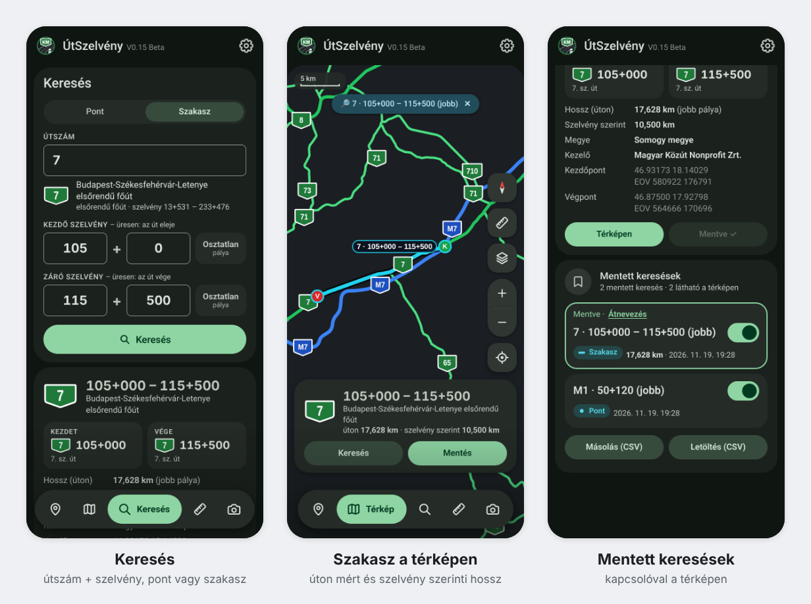
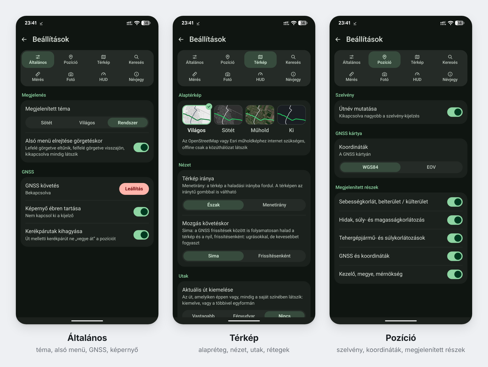

<h1 align="center">ÚtSzelvény</h1>

<b>Pontosan tudod, hol jársz az úton!</b>

Az <b>ÚtSzelvény</b> megmutatja, melyik országos közúton és melyik kilométerszelvényben állsz, internet nélkül is.
A telefon GNSS-pozícióját a közúthálózat adataihoz illeszti. Egy pillantással látod az útszámot
és a szelvényt, valamint mindazt, ami az adott szakaszra vonatkozik.

Terepi munkára is alkalmas. Útszám és szelvény alapján megkeres egy pontot vagy egy útszakaszt a térképen. Mérhetsz vele szelvénytől szelvényig, akár több úton át, vagy pontokat lerakva a térképen.
Fotóidra ráírja a helyet és az időt, a méréseidet pedig elnevezheted és akár CSV-be mentheted.

Böngészőben és Android-alkalmazásként is fut. Az úthálózati adatok a készüléken vannak, így a szelvényezés internet
nélkül is működik. Csak a térkép alapréteghez kell internetkapcsolat.

**Verzió:** V0.16.6 Beta · [Változásnapló](CHANGELOG.md) · © schafler55 · Licenc: GPL-3.0

## Funkciók

### Pozíció
Útszám az útjelző tábla formájában, kilométerszelvény (km+m), szelvényirány, az út neve és kategóriája.
Alatta az érvényes sebességkorlát (belterület / külterület), átkelési szakaszon a település nevével, a következő 3 km hídjai és út feletti akadályai,
a tehergépjármű- és súlykorlátozások, a GNSS-adatok és a kezelő. Párhuzamos utaknál a közeli út egy koppintással választható.
Az Android alkalmazás a használt és látható műholdakat is mutatja rendszerenként (GPS, Galileo, GLONASS, BeiDou…).
Budapest belterületén jelzi, hogy a fővárosi és kerületi utak nem részei az országos közúthálózatnak.

### Térkép
Országos közúthálózat útszám-táblákkal (autópálya, autóút kék, főút zöld), alaprétegként OpenStreetMap (szürke vagy sötét)
vagy műholdkép. Északkal felfelé vagy menetirány szerint forgatva. Koppintásra megmutatja a pont útját és szelvényét.

### Keresés
Útszám és kilométerszelvény (km+m) megadásával megkeresi a pontot a térképen, kezdő és záró szelvénnyel pedig
a teljes útszakaszt (úton mért és szelvény szerinti hosszal, megyével, kezelővel). Nem létező szelvénynél a legközelebbit mutatja.
A keresések elmenthetők és elnevezhetők, egyenként kapcsolóval jeleníthetők meg a térképen.

### Mérés
- **GNSS-mérés:** indítás és leállítás között méri a megtett utat és a szelvény szerinti hosszt; több úton át szakaszokra bont, közbenső pontokat rögzít.
- **Mérés a térképen:** lerakott pontok között légvonal, úton mért (legrövidebb útvonal az országos hálózaton) és szelvény szerinti távolság.
- **Mentett mérések:** elnevezhetők, térképen megjeleníthetők, CSV-be exportálhatók.

### Fotó
Fénykép a helyszínről útszámmal, szelvénnyel, dátummal és idővel a kép tetején (koordináta és égtáj is kérhető),
a pozíció a kép adatai közé (EXIF) is bekerül. Az Android alkalmazás alapból a Képek / ÚtSzelvény mappába ment;
a beállításokban a DCIM / ÚtSzelvény, a DCIM / Camera vagy bármely választott mappa is megadható.
Az Android alkalmazásban a hangerőgombokkal (vagy Bluetooth-os távkioldóval) is lehet exponálni.

Látványterv: valódi, az alkalmazással készült fotók, a bélyegző a jelenlegi verzió elrendezésével újrarajzolva; a rendszámok kitakarva.

### HUD mód
A műszerfalra fektetett telefon képe a szélvédőn tükröződik: fekete háttér, nagy, fényes útszám és szelvény,
igény szerint haladási irány, sebesség és sebességkorlát. Tükrözés, fekvő / álló tájolás és szín állítható;
az Android alkalmazás teljes képernyőre vált és maximális fényerőre állítja a kijelzőt. A beállítások HUD lapján indítható, ott vannak a további beállításai is.

### Beállítások
Fülekre bontva (Általános, Pozíció, Térkép, Keresés, Mérés, Fotó, HUD, Névjegy); mindig az aktuális oldal fülén nyílik meg.
Koordináták: WGS84 (alapértelmezett) vagy EOV.

## Használat

- **Webalkalmazás (telepítés nélkül):** https://schafler55.github.io/kozutszelveny/
  Böngészőben megnyitva az első betöltés után internet nélkül is működik, könyvjelzőként menthető az asztalra.
- **Android APK (telepítve):** https://github.com/schafler55/kozutszelveny/releases/download/apk-latest/UtSzelveny.apk
  Letöltés után engedélyezni kell az ismeretlen forrásból történő telepítést.

A térkép alapréteg (OpenStreetMap vagy Esri műholdkép) internetkapcsolatot igényel; minden más adat az alkalmazásba van építve.
A térkép északkal felfelé vagy menetirány szerint elforgatva is használható.

## Felépítés

| Fájl / mappa | Tartalom |
|---|---|
| `index.html` | A teljes alkalmazás (kód + beépített úthálózati adatok), egyetlen fájl |
| `sw.js`, `manifest.webmanifest`, `icon-*.png` | Telepíthető webalkalmazás (PWA) offline gyorsítótárral |
| `android/` | Android keret (WebView), amely az `index.html`-t futtatja |
| `.github/workflows/android.yml` | Megépíti az APK-t: a `main` ágból a fenti letöltési linkre, a többi ágból teszt APK-t és teszt weboldalt (`teszt/<ág>/`) |
| `CHANGELOG.md` | Változásnapló: mi változott az egyes verziókban |
| `screenshots/` | A README képei |

Az APK mindig a repó gyökerében lévő `index.html`-ből épül, ezért új verzióhoz elég az `index.html`-t cserélni.

## Adatforrás és felelősség

- Útadatok: Magyar Közút Nonprofit Zrt. – Nemzeti Adathozzáférési Pont (NAP), statikus adatcsomagok
  (adatállapot: 2026. november): Országos közúthálózat, Közút neve/kategóriája/kezelője, Szelvényjelek,
  Sebességkorlátozás, Lakott területi szakaszok, Hídhasználati feltételek, Tehergépjárművekre vonatkozó
  korlátozások. Az adatokra a NAP felhasználási
  feltételei vonatkoznak, nem a GPL-3.0 licenc.
- Térkép alapréteg: © OpenStreetMap közreműködők. Műholdkép: © Esri, Maxar, Earthstar Geographics (Esri World Imagery).
- Az adatok tájékoztató jellegűek, nem hitelesek – a helyszíni jelzések és a KRESZ az irányadók.
  Vezetés közben ne kezeld az alkalmazást.

Az alkalmazás Claude Opus 5.5 segítségével készült.
