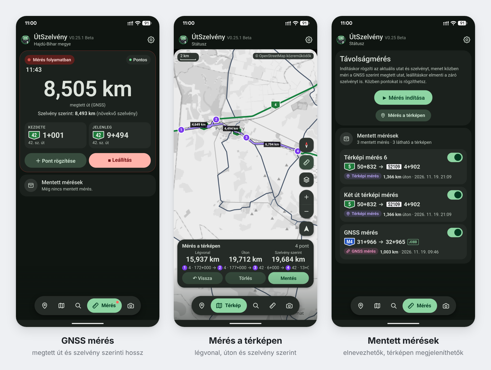
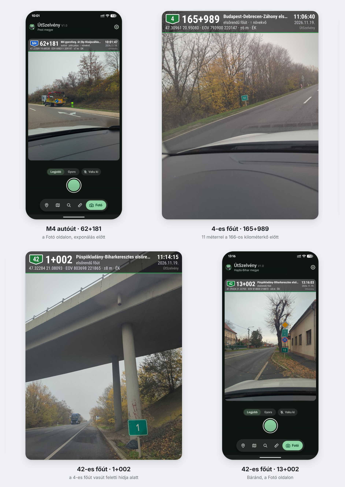
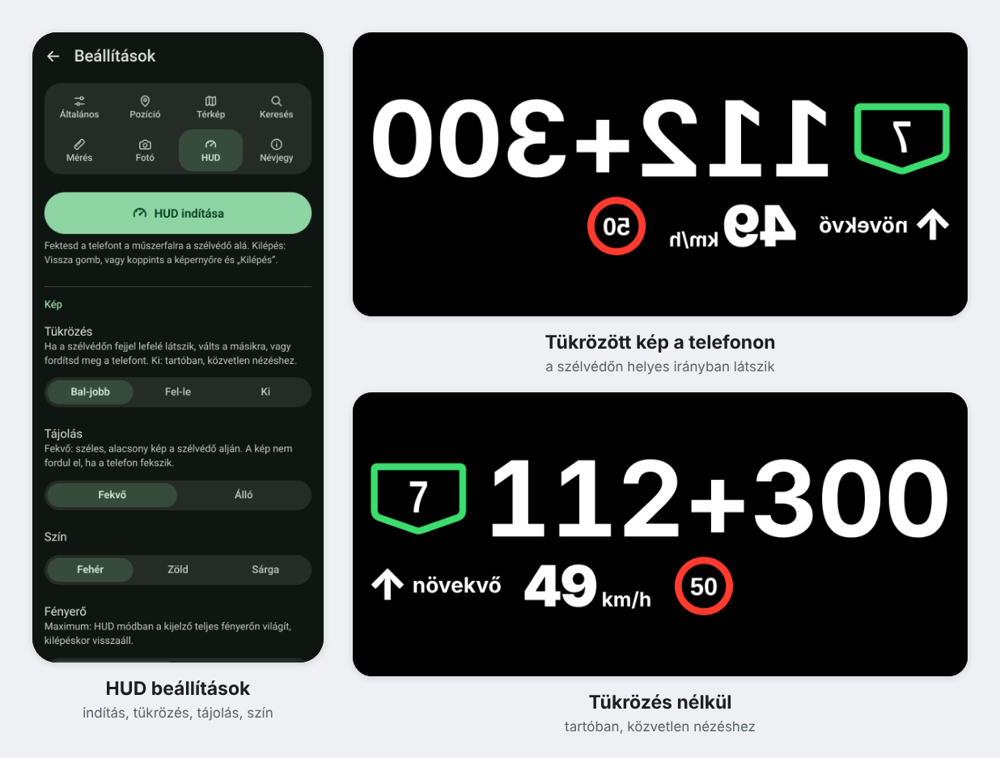

<h1 align="center">ÚtSzelvény</h1>

<b>Kilométerkő minden méteren – a zsebedben.</b>

Az <b>ÚtSzelvény</b> megmutatja, melyik országos közúton és melyik kilométerszelvényben állsz, internet nélkül is.
A telefon GNSS pozícióját a közúthálózat adataihoz illeszti. Egy pillantással látod az útszámot
és a szelvényt, valamint mindazt, ami az adott szakaszra vonatkozik.

Terepi munkára is alkalmas. Útszám és szelvény alapján megkeres egy pontot vagy egy útszakaszt a térképen. Mérhetsz vele szelvénytől szelvényig, akár több úton át, vagy pontokat lerakva a térképen.
Fotóidra ráírja a helyet és az időt, a méréseidet pedig elnevezheted és akár CSV-be mentheted.

Böngészőben és Android-alkalmazásként is fut. Az úthálózati adatok a készüléken vannak, így a szelvényezés internet
nélkül is működik. Csak a térkép alapréteghez kell internetkapcsolat.

**Verzió:** V1.1.3 · [Változásnapló](CHANGELOG.md) · © 2026 Szászi Dániel · Licenc: GPL-3.0

## Funkciók

### Pozíció
Útszám az útjelző tábla formájában, kilométerszelvény (km+m), szelvényirány, az út neve és kategóriája.
Alatta az érvényes sebességkorlát (belterület / külterület), átkelési szakaszon a település nevével, a következő 3 km hídjai és út feletti akadályai,
a tehergépjármű- és súlykorlátozások, a GNSS adatok és a kezelő. Párhuzamos utaknál a közeli út egy koppintással választható.
Az Android alkalmazás a használt és látható műholdakat is mutatja rendszerenként (GPS, Galileo, GLONASS, BeiDou…).
Budapest belterületén jelzi, hogy a fővárosi és kerületi utak nem részei az országos közúthálózatnak.

### Térkép
Országos közúthálózat útszám-táblákkal (autópálya, autóút kék, főút zöld), alaprétegként OpenStreetMap (világos vagy sötét)
vagy műholdkép. Északkal felfelé vagy menetirány szerint forgatva. Koppintásra megmutatja a pont útját és szelvényét; onnan a pont elmenthető keresésként, az Utcakép gomb megnyitja a Google Utcaképet (Google Térkép alkalmazásban vagy új böngészőlapon) a menetirány felé nézve, az Adatok pedig a szakasz minden adatát mutatja (kezelő, sávok, burkolat, forgalom, sebességkorlát, terület, híd, tehergépjármű-korlátozás). A kilométerszelvények pontként és az út mellé mutató vonalkával látszanak (osztott pályán kifelé), a hidak nagyobb nagyításnál (mindkettő kikapcsolható, a nagyítási szint állítható); ahol egy országos út egy másik felett halad át, a magasságkorlát az alatta haladó úton jelenik meg.

### Keresés
Útszám és kilométerszelvény (km+m) megadásával megkeresi a pontot a térképen, kezdő és záró szelvénnyel pedig
a teljes útszakaszt (úton mért és szelvény szerinti hosszal, megyével, kezelővel). Nem létező szelvénynél a legközelebbit mutatja.
Koordináta módban WGS84 vagy EOV koordinátát (beírva vagy beillesztve, a saját GNSS-pozíció egy gombbal) a legközelebbi országos út szelvényéhez köt – pontként vagy két ponttal szakaszként; ezek a keresések limezöld színűek.
A keresések elmenthetők és elnevezhetők, egyenként kapcsolóval jeleníthetők meg a térképen. Az alkalmazás minden koordinátája hosszú nyomással vágólapra másolható.

### Mérés
- **GNSS mérés:** indítás és leállítás között méri a megtett utat és a szelvény szerinti hosszt; több úton át szakaszokra bont, közbenső pontokat rögzít.
- **Mérés a térképen:** lerakott pontok között légvonal, úton mért (legrövidebb útvonal az országos hálózaton) és szelvény szerinti távolság.
- **Mentett mérések:** elnevezhetők, térképen megjeleníthetők, CSV-be exportálhatók.

### Fotó
Fénykép a helyszínről útszámmal, szelvénnyel, dátummal és idővel a kép tetején (koordináta és égtáj is kérhető),
a pozíció a kép adatai közé (EXIF) is bekerül. Az Android alkalmazás alapból a Képek / ÚtSzelvény mappába ment;
a beállításokban a DCIM / ÚtSzelvény vagy bármely választott mappa is megadható.
Az Android alkalmazásban a hangerőgombokkal (vagy Bluetooth-os távkioldóval) is lehet exponálni.

Valódi, az alkalmazással készült fotók (Pixel 7 Pro, 2026. 11. 19.), a bélyegzővel együtt, ahogy az alkalmazás elmentette; kettő a Fotó oldal képernyőképébe illesztve, ahogy exponálás előtt látszik.

### HUD mód
A műszerfalra fektetett telefon képe a szélvédőn tükröződik: fekete háttér, nagy, fényes útszám és szelvény,
igény szerint haladási irány, sebesség és sebességkorlát. Tükrözés, fekvő / álló tájolás és szín állítható;
az Android alkalmazás teljes képernyőre vált és maximális fényerőre állítja a kijelzőt. A beállítások HUD lapján indítható, ott vannak a további beállításai is.

### Beállítások
Fülekre bontva (Általános, Pozíció, Térkép, Keresés, Mérés, Fotó, HUD, Névjegy); mindig az aktuális oldal fülén nyílik meg.
Koordináták: WGS84 (alapértelmezett) vagy EOV.

## Használat

- **Webalkalmazás (telepítés nélkül):** https://schafler55.github.io/utszelveny/ – a legutóbbi stabil kiadás.
  Böngészőben megnyitva az első betöltés után internet nélkül is működik, könyvjelzőként menthető az asztalra.
  A `main` ág legfrissebb, még nem kiadott állapota (fejlesztői oldal, saját mentett adatokkal): https://schafler55.github.io/utszelveny/dev/
- **Android APK (telepítve):** https://github.com/schafler55/utszelveny/releases/latest – a legutóbbi stabil kiadás (pl. `UtSzelveny-V1.0.apk`).
  Letöltés után engedélyezni kell az ismeretlen forrásból történő telepítést.
  A `main` ág legfrissebb, még nem kiadott állapota: [apk-latest](https://github.com/schafler55/utszelveny/releases/tag/apk-latest).
- **Frissítés a béta változatokról (V0.x) a V1.0-ra:** a V1.0-tól az APK új aláírókulccsal készül, ezért a béta APK-t előbb el kell távolítani.
  Ezzel a mentett mérések és keresések is törlődnek, ezért előtte érdemes CSV-be menteni őket.
- **Frissítések:** indításkor az alkalmazás megnézi, megjelent-e új stabil verzió (Beállítások → Általános → Frissítések, kikapcsolható; kézzel: Névjegy → Frissítések → Ellenőrzés).
  A webalkalmazás a „Frissítés” gombra azonnal, a „Később” után a következő indításkor tölti be az új verziót.
  Az Android alkalmazás a „Frissítés” gombra megnyitja az új APK letöltését; a letöltött fájlt megnyitva az Android a meglévő alkalmazásra telepíti. Egy verzió ki is hagyható.
  A mentett mérések, keresések és beállítások frissítéskor megmaradnak.

A térkép alapréteg (OpenStreetMap vagy Esri műholdkép) internetkapcsolatot igényel; minden más adat az alkalmazásba van építve.
A térkép északkal felfelé vagy menetirány szerint elforgatva is használható.

## Felépítés

| Fájl / mappa | Tartalom |
|---|---|
| `web/` | A webalkalmazás; a legutóbbi stabil kiadásé a https://schafler55.github.io/utszelveny/, a `main` ágé a https://schafler55.github.io/utszelveny/dev/ címre kerül |
| `web/index.html` | A teljes alkalmazás (kód + beépített úthálózati adatok), egyetlen fájl |
| `web/sw.js`, `web/manifest.webmanifest`, `web/icon-*.png` | Telepíthető webalkalmazás (PWA) offline gyorsítótárral |
| `android/` | Android keret (WebView), amely a `web/index.html`-t futtatja |
| `.github/workflows/android.yml` | Megépíti az APK-t: a `main` ágból a fenti letöltési linkre, a többi ágból teszt APK-t |
| `.github/workflows/pages.yml` | Kiteszi a weboldalt a GitHub Pagesre: a legutóbbi stabil kiadás `web/` mappáját, a `main` ágat a `dev/` alá, és minden másik ágból egy teszt oldalt (`teszt/<ág>/`); a törölt ág teszt oldala eltűnik. Új stabil kiadás közzétételekor magától frissül |
| `CHANGELOG.md` | Változásnapló: mi változott az egyes verziókban |
| `web/szovegek.html` | Az alkalmazás összes szövege képernyőnként (kereshető, szerkeszthető), a `main` ág szerint: https://schafler55.github.io/utszelveny/dev/szovegek.html |
| `tools/szovegek.py` | Ellenőrzi a `web/index.html` szövegblokkját (érvényes JSON, minden kulcs megvan); a build is futtatja |
| `tools/nap_szakaszadatok.py` | A NAP sáv-, burkolat- és forgalmi adatait (WFS GeoJSON) a `web/index.html` beépített adatai közé írja |
| `screenshots/` | A README képei |

A webalkalmazás és az APK is ugyanabból a `web/index.html`-ből épül, ezért új verzióhoz elég azt cserélni.

## Szövegek

Az alkalmazás minden felirata, magyarázata és gombszövege egy helyen van: a `web/index.html` elején, a `<script type="application/json" id="texts">` blokkban, képernyők szerint csoportosítva (pl. `position`, `search`, `settings`). A kód csak a kulcsokra hivatkozik (`TX("search.title")`, `data-tx="search.title"`).

Áttekintés és szerkesztés: **[szovegek.html](https://schafler55.github.io/utszelveny/dev/szovegek.html)** – kereshető lista; a módosítások a böngészőben maradnak, a „Copy changes” rövid listát másol, a „Download index.html” a módosított teljes fájlt adja, ami GitHubon feltölthető. A `{kapcsos}` helyőrzőket (útszám, távolság…) és a HTML-jelöléseket (`<b>`, ` `) meg kell hagyni.

## Adatforrás és felelősség

- Útadatok: Magyar Közút Nonprofit Zrt. – Nemzeti Adathozzáférési Pont (NAP), statikus adatcsomagok
  (adatállapot: 2026. november): Országos közúthálózat, Közút neve/kategóriája/kezelője, Szelvényjelek,
  Sebességkorlátozás, Lakott területi szakaszok, Hídhasználati feltételek, Tehergépjárművekre vonatkozó
  korlátozások, Összes gépjármű forgalmi sávok száma, Burkolat típusa és szélessége, Éves keresztmetszeti
  forgalmi adatok (2025), Közúti azonosítópontok. **Az adatokra a NAP felhasználási
  feltételei vonatkoznak, nem a GPL-3.0 licenc.**
- Térkép alapréteg: © OpenStreetMap közreműködők (ODbL). 
  Műholdkép: © Esri, Maxar, Earthstar Geographics, GIS User Community (Esri World Imagery).
- Az adatok tájékoztató jellegűek, nem hitelesek. A helyszíni jelzések és a KRESZ az irányadók.
  Vezetés közben ne kezeld az alkalmazást.

Az alkalmazás Claude Opus 5.5 segítségével készült.

## Adatvédelem

<b>Az alkalmazás nem gyűjt és nem továbbít személyes adatokat:</b> nincs fiók, reklám vagy analitika. A helyadataid, méréseid, kereséseid és beállításaid csak helyben tárolódnak, a fotók pedig közvetlenül a készülékedre mentődnek.
Az alaptérkép az OpenStreetMap és az Esri szervereiről töltődik le, így ezek a szolgáltatók – mint bármely weboldal esetében – látják az IP-címedet és a betöltött térképrészletet. Az Utcakép gomb a Google Térképet, a Névjegy Támogatás gombja a Revolut fizetési oldalát nyitja meg.
A frissítések keresése (Beállítások → Általános, kikapcsolható) a GitHub szerveréről kérdezi le a legújabb verzió számát, így a GitHub látja az IP-címedet.

## Támogatás

Az ÚtSzelvény ingyenes, és az is marad: nincs benne reklám, előfizetés vagy fizetős funkció. A fejlesztést a szabadidőmben végzem.
Ha hasznosnak találod, egy kávé árával támogathatod a munkát: **[revolut.me/schafler55](https://revolut.me/schafler55)**.
A támogatás önkéntes, és nem jár érte extra funkció. A visszajelzés és az ötletek is sokat segítenek!

*ÚtSzelvény is free and will stay free – no ads, subscriptions or paid features. If you find it useful, you can support the work via [Revolut](https://revolut.me/schafler55). Donations are voluntary and unlock nothing.*

## Közreműködés

**Hibajelentést és ötletet issue-ként szívesen fogadok,** de a projekt nem fogad el kódhozzájárulást, a pull requesteket a rendszer automatikusan lezárja. Részletek: [CONTRIBUTING.md](CONTRIBUTING.md).
