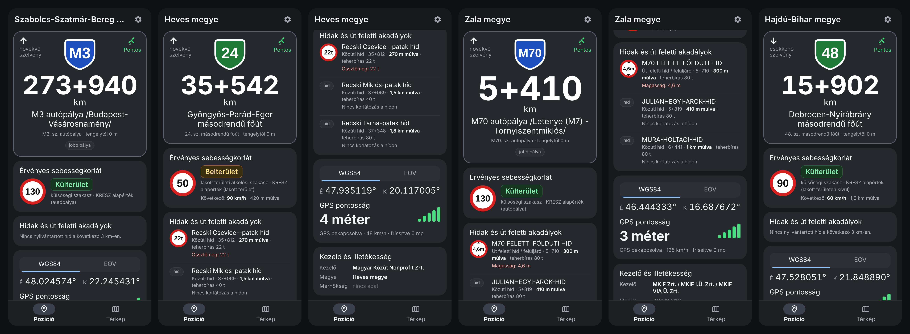
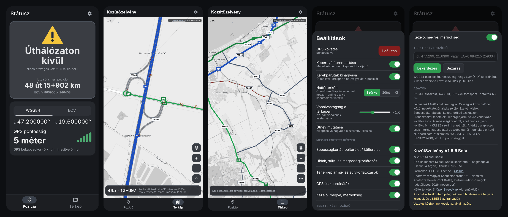

# KözútSzelvény

Offline útszám és kilométerszelvény kijelző a magyar országos közúthálózathoz.
A telefon GPS-pozíciójából megmutatja, melyik úton és melyik szelvényben vagy,
valamint a sebességkorlátot, a lakott területi (átkelési) szakaszt, a közeli hidak súly- és
magasságkorlátozásait, a tehergépjárművekre vonatkozó korlátozásokat, a kezelőt és a megyét.

**Verzió:** V1.5.2 Beta · © schafler55 · Licenc: GPL-3.0

## Képernyőképek

## Használat

- **Webalkalmazás (telepíthető):** https://schafler55.github.io/kozutszelveny/
  Chrome-ban megnyitva ⋮ menü → *Hozzáadás a kezdőképernyőhöz*. Első betöltés után internet nélkül is működik.
- **Android APK:** https://github.com/schafler55/kozutszelveny/releases/download/apk-latest/KozutSzelveny.apk
  Letöltés után engedélyezd az ismeretlen forrásból történő telepítést.

A háttértérkép (OpenStreetMap) internetkapcsolatot igényel; minden más adat az alkalmazásba van építve.

## Felépítés

| Fájl / mappa | Tartalom |
|---|---|
| `index.html` | A teljes alkalmazás (kód + beépített úthálózati adatok), egyetlen fájl |
| `sw.js`, `manifest.webmanifest`, `icon-*.png` | Telepíthető webalkalmazás (PWA) offline gyorsítótárral |
| `android/` | Android keret (WebView), amely az `index.html`-t futtatja |
| `.github/workflows/android.yml` | Minden `main`-re feltöltéskor automatikusan megépíti az APK-t |

Az APK mindig a repó gyökerében lévő `index.html`-ből épül, ezért új verzióhoz elég az `index.html`-t cserélni.

## Adatforrás és felelősség

- Útadatok: Magyar Közút Nonprofit Zrt. – Nemzeti Adathozzáférési Pont (NAP), statikus adatcsomagok
  (adatállapot: 2026. november): Országos közúthálózat, Közút neve/kategóriája/kezelője, Szelvényjelek,
  Sebességkorlátozás, Lakott területi szakaszok, Hídhasználati feltételek, Tehergépjárművekre vonatkozó
  korlátozások. Az adatokra a NAP felhasználási
  feltételei vonatkoznak, nem a GPL-3.0 licenc.
- Háttértérkép: © OpenStreetMap közreműködők.
- Az adatok tájékoztató jellegűek, nem hitelesek – a helyszíni jelzések és a KRESZ az irányadók.
  Vezetés közben ne kezeld az alkalmazást.

Az alkalmazás AI segítségével készült (Gemini 4 Argon, Claude Opus 5.5).
